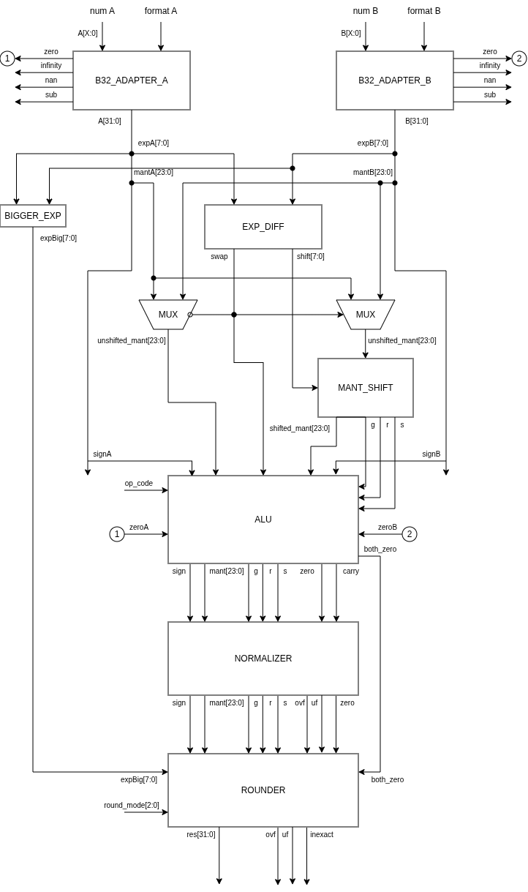

<h1 align="center">Nano FP unit</h1>

This repository contains the source code of a digital unit that is meant to be compliant with the IEEE 754-2019 Std.

So far, for the proper behavior of the unit, some asumptions must be taken into account:

- Signals connected to the *num* input must be 32-bit wide to avoid zero extensions of the signal.

## Dependencies

- [Icarus Verilog](https://steveicarus.github.io/iverilog/) - Currently, simulations are only supported via icarus verilog.
- [GTKWave](https://gtkwave.github.io/gtkwave/) - It is used to visualize the waveforms of the design.

## Block Diagram

The structure of the design is depicted in the following block diagram:

